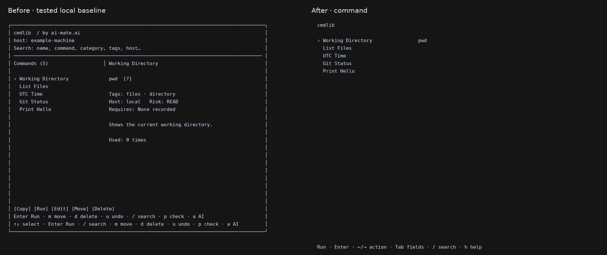

# Focused terminal UI

The default view shows the selected name once and gives the command the detail pane.
Other results are muted. Host, risk, tags, prerequisites and explanations are available
in Details; the description has its own layer. Empty metadata rows are omitted until
selected, so they remain editable. The actual execution host is always shown in run review.

These previews render the actual View output with synthetic fixtures in monochrome.
They are documentation renders, not screenshots of the owner's personal library.
The normal terminal also uses bold and accent/muted styles.

## Direct editing

Tab switches between the result list and field focus. In field focus, left/right
switches Command, Description and Details, and up/down selects a field.
Press e to edit that field in place, Enter to save, or Esc to discard.
Alt+Enter (or Ctrl+J) inserts a newline; ordinary multiline paste is preserved.
Editing one field preserves all other content except an unchanged explanation when
the command changes. Writes use existing validation, conflict checks and backups.

Press r to review a run, c to copy, ? to explain, or h for tutorial/full controls.
Normal list left/right still selects the active action. New entries use n, Tab to
switch fields, Enter to save and Esc to cancel. Category rename, move, delete,
undo, maintenance and the one-shot queued advisor remain available.

## Run review

Every run requires explicit confirmation. There is no automatic countdown, including
when an old .run-policy.json exists. READ/CONNECT accept Enter or Space; WRITE requires
WRITE; DANGER requires RUN followed by the entry ID. Paste cannot approve a run.
Risk and Host are metadata and do not validate safety or select an execution machine.

## Validation

- Local Go baseline restored from the tested category-rename source snapshot before UI changes.
- gofmt, go test ./... and go vet ./... passed on native macOS Intel.
- Built from the repository root and started the resulting binary in a native PTY.
- Native checks cover fresh-shell startup, search/paste, command discovery, explicit
  confirmation/cancellation, harmless execution, inline save/cancel, existing install
  smoke checks, category rename/undo, move/delete/undo, backups and idle maintenance.
- Tests cover multiline preservation, individual field isolation, concurrent edits,
  narrow terminal controls and legacy policies that cannot auto-start.
- A human visual review in a visible Terminal.app window and installation over the
  existing personal executable have not been performed. The personal installation
  remains the existing build until that review.

PR #3 and its cmdlib-add branch are independent and were not changed.
